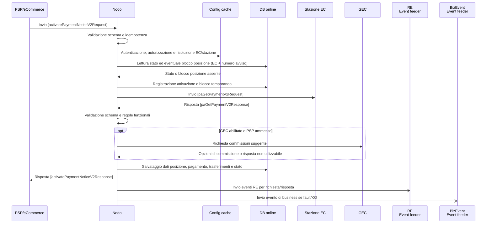

# Primitiva activatePaymentNoticeV2

## Scopo

La primitiva consente ad un attore di avviare l'attivazione di una posizione debitoria e ottenere i dati necessari a proseguire il pagamento. Il Nodo autentica e autorizza il chiamante, individua l'EC e la stazione competenti, verifica che la posizione possa essere attivata, interroga la stazione e restituisce i dati verificati insieme ad un `paymentToken`. Per alcuni PSP e quando abilitato dalla configurazione, il Nodo interroga anche il servizio GEC per ottenere le commissioni da suggerire.

L'esito positivo non rappresenta il pagamento concluso: la posizione e il pagamento vengono registrati nello stato `PAYING`, in attesa dei passaggi successivi.

---

## Panoramica del flusso

L'idempotenza, se abilitata, è gestita prima dell'elaborazione della primitiva: una richiesta già registrata con la stessa chiave e lo stesso contenuto riceve la risposta memorizzata. Una chiave già associata a contenuto diverso produce `PPT_ERRORE_IDEMPOTENZA`. In assenza di una risposta in cache, la richiesta prosegue nel flusso.

---

## Flusso dettagliato

### Validazione, autorizzazione e risoluzione

1. Il Nodo valida il messaggio `activatePaymentNoticeV2Request` rispetto al contratto SOAP. Errori di formato o parsing sono restituiti con `PPT_SINTASSI_EXTRAXSD`.
2. Il Nodo verifica il limite del campo `expirationTime` passato in richiesta. Il valore non deve superare la durata massima, configurata per il token attraverso la Configuration Key `default_token_duration_validity_millis`: in caso contrario restituisce `PPT_AUTORIZZAZIONE`.
3. Sulla configurazione in cache, sono verificati l'esistenza e lo stato di attivazione del PSP, dell'intermediario PSP e del suo canale (compresa la corrispondenza della password), la relazione canale/intermediario, la relazione PSP/canale e il modello del canale (di cui è accettato unicamente un canale con modello di pagamento `ATTIVATO_PRESSO_PSP`). Errori di autenticazione, configurazione o abilitazione interrompono il flusso con i fault indicati nella tabella degli errori.
4. Il codice fiscale dell'EC e il numero avviso contenuti in `qrCode` sono usati per risolvere l'EC, l'intermediario EC e la stazione (estraendoli dall'Aux Digit e dal codice segregazione). Il Nodo ricava dal numero avviso i dati di instradamento e verifica le associazioni configurate tra EC, stazione e intermediario EC. Una relazione non valida o un soggetto non abilitato impedisce l'inoltro.

### Controlli e scritture sul DB

- La posizione è identificata dalla coppia codice fiscale dell'EC e numero avviso (colonne `pa_fiscal_code` e `notice_id`). Il Nodo legge e blocca da DB (in "select for update") il record dalla tabella `position_status_snapshot` per serializzare le attivazioni concorrenti.
- Se lo stato della posizione è `PAYING`, l'attivazione è rifiutata e si restituisce l'errore `PPT_PAGAMENTO_IN_CORSO`.
- Se lo stato della posizione è `PAID` o `NOTIFIED`, l'attivazione è rifiutata e si restituisce l'errore `PPT_PAGAMENTO_DUPLICATO`.
- Se una stazione è versione 1 e lo stato della posizione è `NOTICE_STORED`, l'attivazione è rifiutata e si restituisce l'errore `PPT_PAGAMENTO_DUPLICATO`.
- Se non è già presente un'attivazione in corso, il Nodo genera un `paymentToken` casuale e registra l'attivazione nella tabella `position_activate`, impostandovi PSP, chiave d'idempotenza, importo e dati della richiesta. Le colonne `payment_method` e `touchpoint` sono memorizzati se forniti nella richiesta. La durata del token (attraverso le colonne `token_valid_from` e `token_valid_to`) è calcolata usando l'istante di arrivo della richiesta a cui va sommato il valore di `expirationTime` passato in richiesta (oppure la durata predefinita in Configuration Key).
- Se esiste uno snapshot della posizione (precedentemente recuperato da `position_status_snapshot`, il Nodo pone il valore della colonna `activation_pending`a `Y`, per impedire che un esito di pagamento concorrente venga acquisito prima della risposta.
- Si esegue la richiesta verso la stazione dell'EC. Dopo la risposta, il Nodo riacquisisce il blocco e verifica che la posizione non sia stata attivata nel frattempo. In caso di errore o risposta non valida, rimuove il flag pendente.
- Dopo una risposta positiva e superati i controlli, il Nodo salva nel DB online i dati ricevuti e aggiorna lo stato della posizione e dell'attivazione:
    - `position_service` contiene i dati descrittivi della posizione (descrizione, denominazione dell'EC e ufficio) ed è creata se la posizione non esiste. Se esiste, questi dati sono aggiornati.
    - `position_subject` contiene i dati del debitore, il cui riferimento al debitore è salvato in `position_service`. Per una posizione già esistente il record del debitore viene aggiornato.
    - `position_payment_plan` contiene il piano relativo all'avviso: riferimento del creditore, scadenza, importo, indicatore di pagamento finale e metadata. Un piano con lo stesso importo viene aggiornato, altrimenti ne viene creato uno nuovo.
    - `position_payment` registra il pagamento avviato inclusi PSP, stazione, token e dati della richiesta.
    - `position_transfer` contiene i singoli "transfer" comunicati dalla stazione con i relativi importi, beneficiari e metadata.
    - `position_status_snapshot` e `position_payment_status_snapshot` conservano lo stato corrente della posizione e del pagamento. Le rispettive tabelle `position_status` e `position_payment_status` registrano lo storico dei cambi di stato.
    - `position_activate`, già creata all'avvio dell'attivazione, viene aggiornata con il riferimento del creditore e la validità del `paymentToken`.

  Il nuovo stato della posizione e quello del pagamento sono `PAYING`; il flag `activation_pending` viene riportato a `N`. Il salvataggio rispetta i vincoli di unicità: una collisione concorrente è restituita come `PPT_PAGAMENTO_IN_CORSO`.
- Sono salvati i dati dei trasferimenti, compresi gli eventuali metadata ricevuti e il fatto che l'attivazione sia passata da stand-in. I metadata sono conservati nel DB mentre quelli restituiti al PSP sono filtrati secondo il dizionario di metadata attivo.
- Una risposta idempotente positiva o negativa può essere memorizzata in `idempotency_cache`, secondo configurazione. Gli errori sintattici `PPT_SINTASSI_EXTRAXSD` non sono memorizzati dal percorso della primitiva.

### Interazione con la stazione

In base alla versione di primitiva della stazione, si seleziona la primitiva corretta da inviare verso l'Ente Creditore secondo le sue caratteristiche:

- per stazioni di versione 1, il Nodo invio delle chiamate `paaAttivaRPT`;
- per stazioni di versione superiore a 1, invia `paGetPayment` se la stazione dichiara la primitiva 1, altrimenti invia `paGetPaymentV2`.

La richiesta trasmette l'identificativo dell'EC, dell'intermediario EC e della stazione, il `qrCode` e l'importo, mentre `paymentNote` e `dueDate` sono inoltrati solo se presenti. Per `paGetPaymentV2`, il campo `transferType` è definito come `POSTAL` per i canali Poste mentre `PAGOPA` per il PSP eCommerce, in tutti gli altri casi non è valorizzato. Nel percorso `paGetPayment` è definito come `POSTAL` per i canali Poste, altrimenti il campo è omesso.

Se la stazione originale è configurata per lo stand-in, la chiamata è indirizzata alla stazione sostitutiva configurata e l'utilizzo dello stand-in viene registrato sul pagamento. Il campo `standin` della risposta al PSP è valorizzato solo quando il canale è configurato per esporlo.

La risposta viene validata contro lo schema della versione ricevuta e poi sottoposta a controlli funzionali:

- `outcome=OK` richiede dati e assenza di fault, `outcome=KO` deve contenere un fault e non dati. Le combinazioni incoerenti e gli outcome non validi producono `PPT_STAZIONE_INT_PA_ERRORE_RESPONSE`.
- L'importo deve essere positivo e deve corrispondere alla somma dei `transferAmount`. Gli `idTransfer` devono essere distinti e consecutivi e devono partire da `1`.
- Quando è attivo il controllo di descoping (tramite Configuration Key `mod3_descoping`), `creditorReferenceId` deve corrispondere allo IUV ricavato dal numero avviso. Per la richiesta V2 il controllo è omesso se il PSP o il canale coincidono con il valore di eCommerce.
- Per i trasferimenti con `IBAN`, il Nodo verifica che l'EC sia abilitato e che la coppia codice fiscale EC–IBAN sia censita. Questa verifica non si applica al ramo `richiestaMarcaDaBollo`.
- In `paGetPaymentV2`, se almeno un trasferimento contiene `richiestaMarcaDaBollo`, l'attivazione è consentita solo al PSP eCommerce; altrimenti il Nodo restituisce `PPT_SEMANTICA` con descrizione
`Pagamento non attivabile`. Non esiste un controllo funzionale dell'hash del documento. Il Nodo non confronta `companyName` con i dati anagrafici censiti.

Un fault applicativo valido della stazione con `outcome=KO` è tradotto in `PPT_ERRORE_EMESSO_DA_PAA`. Se abilitato per l'intermediario PSP, il fault bean può includere i campi originali del fault della stazione.

### Interazione con GEC

Il servizio GEC è chiamato internamente solo per la versione 2 delle `activatePaymentNotice` nel caso in cui si sta utilizzando una stazione dalla versione successiva alla 1, a patto che la funzionalità sia abilitata e il PSP non è uno tra eCommerce, AppIO o Checkout.

La richiesta `getFees` viene popolata con i dati dell'EC, del PSP, dell'intermediario del canale, l'importo della posizione, le categorie dei transfer, il metodo di pagamento e il touchpoint. Se non forniti dal PSP, i valori inviati a GEC sono rispettivamente `ANY` e `PSP`. Gli importi delle commissioni ricevuti da GEC sono convertiti da centesimi a importi con due decimali.

Tra le opzioni ricevute, il Nodo seleziona la prima corrispondente al PSP chiamante e, se presenti, include i campi `suggestedUserFee`, `suggestedPaFee`, `suggestedIdBundle` e `suggestedIdCiBundle` nella risposta e li registra nell'attivazione. Se non esiste un'opzione corrispondente, la lista è vuota o la risposta non è utilizzabile, i campi suggeriti sono omessi e l'attivazione prosegue senza commissioni. Per errori HTTP, di trasporto o di parsing, il servizio applica i retry configurati e, esauriti i tentativi gestiti, prosegue senza suggerimenti commissionali.

---

## Errori restituiti al chiamante

Gli errori applicativi della primitiva sono esposti nel body SOAP come `outcome=KO` con `fault`; la risposta SOAP è trasportata con HTTP `200`. I codici di errore sono i valori contrattuali del fault bean.

| Condizione | Codice fault | Descrizione esposta |
| --- | --- | --- |
| XML non valido, parsing non riuscito o richiesta fuori schema | `PPT_SINTASSI_EXTRAXSD` | errore di sintassi. |
| Password del canale errata | `PPT_AUTENTICAZIONE` | richiesta non autenticata. |
| Scadenza superiore al massimo configurato, modello del canale non `ATTIVATO_PRESSO_PSP`, oppure associazioni PSP-canale o EC-stazione non valide | `PPT_AUTORIZZAZIONE` | operazione non autorizzata. |
| PSP, intermediario PSP o canale inesistente o non abilitato | `PPT_PSP_SCONOSCIUTO`, `PPT_PSP_DISABILITATO`, `PPT_INTERMEDIARIO_PSP_SCONOSCIUTO`, `PPT_INTERMEDIARIO_PSP_DISABILITATO`, `PPT_CANALE_SCONOSCIUTO`, `PPT_CANALE_DISABILITATO` | info sull'entità non censita o disabilitata. |
| EC, intermediario EC o stazione inesistente o non abilitata | `PPT_DOMINIO_SCONOSCIUTO`, `PPT_DOMINIO_DISABILITATO`, `PPT_INTERMEDIARIO_PA_SCONOSCIUTO`, `PPT_INTERMEDIARIO_PA_DISABILITATO`, `PPT_STAZIONE_INT_PA_SCONOSCIUTA`, `PPT_STAZIONE_INT_PA_DISABILITATA` | info sul soggetto o sulla stazione non censita o disabilitata. |
| La posizione è `PAYING` o una scrittura concorrente viola l'unicità | `PPT_PAGAMENTO_IN_CORSO` | attivazione già in corso. |
| La posizione è `PAID` o `NOTIFIED`, oppure `NOTICE_STORED` nel caso previsto per le stazioni di versione 1 | `PPT_PAGAMENTO_DUPLICATO` | posizione già pagata/notificata o non attivabile per lo stato corrente. |
| Risposta della stazione non valida per schema, fault, coerenza, importi, trasferimenti, IUV o IBAN | `PPT_STAZIONE_INT_PA_ERRORE_RESPONSE` | risposta della stazione rifiutata come non valida. |
| Fault applicativo valido restituito dall'EC | `PPT_ERRORE_EMESSO_DA_PAA` | fault originale riportato nel fault bean esteso quando previsto. |
| Trasferimento con `richiestaMarcaDaBollo` presentato da PSP diverso dall'eCommerce configurato | `PPT_SEMANTICA` | pagamento non attivabile. |
| Problema di connessione verso la stazione | `PPT_STAZIONE_INT_PA_IRRAGGIUNGIBILE` | stazione non raggiungibile. |
| Timeout verso la stazione | `PPT_STAZIONE_INT_PA_TIMEOUT` | timeout della stazione. |
| Errore inatteso non tradotto in un errore più specifico | `PPT_SYSTEM_ERROR` | errore generico. |
| Stazione di versione 1, canale Poste, IBAN di accredito non disponibile o verifica bollettino non completata | `PPT_IBAN_ACCREDITO` | IBAN di accredito non disponibile. |
| Chiave d'idempotenza già usata per contenuto diverso, quando il controllo è abilitato | `PPT_ERRORE_IDEMPOTENZA` | errore di idempotenza. |

---

## Errori e risposte della tratta esterna

| Condizione | Traduzione nel Nodo | Effetto sulla risposta al PSP |
| --- | --- | --- |
| `paGetPayment`/`paGetPaymentV2` con `outcome=KO`, fault presente e dati assenti | `PPT_ERRORE_EMESSO_DA_PAA` | esito `KO`; il fault della PA può essere riportato come fault originale secondo la configurazione del fault bean esteso. |
| Fault assente in un `KO`, fault presente in un `OK`, dati assenti in un `OK`, outcome non valido, XML non valido o risposta non conforme allo schema | `PPT_STAZIONE_INT_PA_ERRORE_RESPONSE` | esito `KO`. |
| Violazione dei controlli funzionali su IUV, importi, trasferimenti, EC o IBAN | `PPT_STAZIONE_INT_PA_ERRORE_RESPONSE` | esito `KO`. |
| Risposta `OK` con MBD richiesta da un PSP non eCommerce | `PPT_SEMANTICA` | esito `KO` con descrizione `Pagamento non attivabile`. |
| Codice HTTP code `502 Bad Gateway` dalla stazione | Il body viene trattato come risposta da interpretare; non supera i controlli sintattici, dunque si applica l'errore di risposta della stazione. | esito `KO`. Il codice HTTP non è inoltrato direttamente al PSP. |
| Altro codice HTTP non `200` dalla stazione | Se il body contiene un fault riconosciuto, si applica la relativa traduzione; in assenza di una traduzione riconosciuta si usa `PPT_STAZIONE_INT_PA_IRRAGGIUNGIBILE`. | esito `KO`. Il codice HTTP non è inoltrato direttamente al PSP. |
| Errore di comunicazione/connessione con la stazione | `PPT_STAZIONE_INT_PA_IRRAGGIUNGIBILE`; un timeout di connessione è tradotto in `PPT_STAZIONE_INT_PA_TIMEOUT`. | esito `KO`. |
| GEC non raggiungibile, codice HTTP non `200`, body vuoto o non decodificabile | Retry secondo configurazione; dopo i tentativi gestiti l'attivazione continua senza commissioni suggerite. | Nessun fault da GEC è restituito al PSP; i campi delle commissioni sono omessi. |

---

## Campi e vincoli contrattuali

### Richiesta `activatePaymentNoticeV2Request` (PSP → Nodo)

| **Campo** | **Descrizione** | **Tipo** | **Cardinalità e vincoli contrattuali** |
| --- | --- | --- | --- |
| `idPSP` | Identificativo PSP chiamante. | Stringa `stIdPSP` | **Obbligatorio**; lunghezza 1–35. |
| `idBrokerPSP` | Identificativo dell'intermediario PSP. | Stringa `stIdBroker` | **Obbligatorio**; lunghezza 1–35. |
| `idChannel` | Identificativo del canale PSP. | Stringa `stIdChannel` | **Obbligatorio**; lunghezza 1–35. |
| `password` | Password del canale. | Stringa `stPassword` | **Obbligatorio**; lunghezza 8–15. |
| `idempotencyKey` | Chiave per la ripetizione idempotente della richiesta. | Stringa `stIdempotencyKey` | Opzionale; pattern `[a-zA-Z0-9]{2,18}_[a-zA-Z0-9]{10}`. |
| `qrCode` | Informazioni univoche della posizione debitoria. | Struttura `ctQrCode` | **Obbligatorio**; contiene i due campi seguenti. |
| `qrCode.fiscalCode` | Codice fiscale dell'EC. | Stringa `stFiscalCodePA` | **Obbligatorio**; 11 cifre. |
| `qrCode.noticeNumber` | Numero avviso. | Stringa `stNoticeNumber` | **Obbligatorio**; 18 cifre. |
| `expirationTime` | Durata del token in millisecondi. | Intero `stExpirationTime` | Opzionale; massimo contrattuale 1.800.000. Il contratto non impone un minimo; non può superare la durata configurata in Configuration Key. |
| `amount` | Importo della posizione debitoria al momento dell'attivazione. | Decimale `stAmount` | **Obbligatorio**; formato con due decimali, massimo 999.999.999,99. Lo schema non impone un minimo, non è presente un controllo di positività. |
| `dueDate` | Data di scadenza della posizione debitoria. | Data ISO `stISODate` | Opzionale. |
| `paymentNote` | Nota sul pagamento. | Stringa `stText210` | Opzionale; lunghezza 1–210. |
| `paymentMethod` | Metodo di pagamento, utile alla richiesta di commissioni. | Stringa enumerata `stPaymentMethodFee` | Opzionale; `BBT`, `BP`, `AD`, `CP`, `PO`, `OBEP`, `JIF`, `MYBK` o `PPAL`; lunghezza massima 4. |
| `touchPoint` | Punto di contatto, utile alla richiesta di commissioni. | Stringa enumerata `stTouchpointFee` | Opzionale; `IO`, `WISP`, `CHECKOUT`, `PSP`, `ATM`, `BETTING`, `TS`, `HB` o `POS`; lunghezza massima 10. |

### Risposta `activatePaymentNoticeV2Response` (Nodo → PSP)

| **Campo** | **Descrizione** | **Tipo** | **Cardinalità e vincoli contrattuali** |
| --- | --- | --- | --- |
| `outcome` | Esito della primitiva. | `stOutcome` | **Obbligatorio**; `OK` o `KO`. |
| `fault` | Dettaglio dell'errore. | `ctFaultBean` | Opzionale; contiene i campi presenti nella [sezione su ctFaultBean](#). |
| `totalAmount` | Importo totale della posizione debitoria. | Decimale `stAmount` | Opzionale; formato con due decimali e massimo 999.999.999,99. |
| `paymentDescription` | Descrizione della posizione debitoria. | Stringa `stText140` | Opzionale; lunghezza 1–140. |
| `fiscalCodePA` | Codice fiscale dell'EC. | Stringa `stFiscalCodePA` | Opzionale; 11 cifre. |
| `companyName` | Denominazione dell'EC. | Stringa `stText140` | Opzionale; lunghezza 1–140. |
| `officeName` | Denominazione dell'ufficio. | Stringa `stText140` | Opzionale; lunghezza 1–140. |
| `paymentToken` | Payment token associato all'attivazione. | Stringa `stPaymentToken` | Opzionale; lunghezza 1–35. |
| `transferList` | Trasferimenti monetari comunicati dall'EC. | Struttura `ctTransferListPSPV2` | Opzionale nella risposta; da 1 a 5 `transfer` quando presente. Contiene i campi seguenti. |
| `transferList.transfer.idTransfer` | Identificativo progressivo del trasferimento. | Intero enumerato `stIdTransfer` | **Obbligatorio**; valori da 1 a 5. Il Nodo verifica inoltre unicità e progressività. |
| `transferList.transfer.transferAmount` | Importo del trasferimento. | Decimale `stAmount` | **Obbligatorio**; formato con due decimali e massimo 999.999.999,99. |
| `transferList.transfer.fiscalCodePA` | Codice fiscale dell'EC beneficiario. | Stringa `stFiscalCodePA` | **Obbligatorio**; 11 cifre. |
| `transferList.transfer.companyName` | Denominazione dell'EC beneficiario. | Stringa `stText140` | Opzionale; lunghezza 1–140. |
| `transferList.transfer.IBAN` | IBAN del trasferimento monetario. | Stringa `stIBAN` | Opzionale nello schema V2; pattern di due lettere, due cifre e da 1 a 30 caratteri alfanumerici. È alternativo a `richiestaMarcaDaBollo`. |
| `transferList.transfer.richiestaMarcaDaBollo` | Dati della richiesta di marca da bollo digitale. | Struttura `ctRichiestaMarcaDaBollo` | Opzionale nello schema V2; alternativa a `IBAN`, non entrambi. Contiene i campi seguenti. |
| `transferList.transfer.richiestaMarcaDaBollo.hashDocumento` | Hash del documento della marca da bollo digitale. | `stBase64Binary72` | **Obbligatorio**; valore base64 con lunghezza contrattuale 4–72. |
| `transferList.transfer.richiestaMarcaDaBollo.tipoBollo` | Tipo di marca da bollo digitale. | `stTipoBolloDigitale` | **Obbligatorio**; valore `01`, lunghezza 2. |
| `transferList.transfer.richiestaMarcaDaBollo.provinciaResidenza` | Codice provincia (o nazione, in alcuni casi). | `stNazioneProvincia` | **Obbligatorio**; due lettere maiuscole. |
| `transferList.transfer.remittanceInformation` | Causale del trasferimento monetario. | Stringa `stText140` | **Obbligatorio**; lunghezza 1–140. |
| `transferList.transfer.transferCategory` | Tassonomia di incasso del trasferimento monetario. | Stringa `stText140` | Opzionale nella risposta al PSP; lunghezza 1–140. Solitamente nel [formato previsto in SANP](https://developer.pagopa.it/it/pago-pa/guides/sanp/ente-creditore/tassonomia-dei-servizi-di-incasso). |
| `transferList.transfer.metadata` | Metadata aggiuntivi del trasferimento monetario. | `ctMetadata` | Opzionale; se presente contiene da 1 a 15 `mapEntry`. |
| `metadata` | Metadata della posizione debitoria. | `ctMetadata` | Opzionale; se presente contiene da 1 a 15 `mapEntry`. |
| `metadata.mapEntry.key` | Chiave del metadata. | Stringa `stText140` | **Obbligatoria**; lunghezza 1–140. |
| `metadata.mapEntry.value` | Valore del metadata. | Stringa `stText140` | **Obbligatoria**; lunghezza 1–140. |
| `creditorReferenceId` | Identificativo di riferimento dell'EC, coincidente con lo IUV. | Stringa `stText35` | Opzionale; lunghezza 1–35. |
| `suggestedUserFee` | Commissione suggerita da GEC a carico dell'utente. | Decimale `stAmount` | Opzionale; formato con due decimali e massimo 999.999.999,99. |
| `suggestedPaFee` | Commissione suggerita da GEC a carico dell'EC. | Decimale `stAmount` | Opzionale; formato con due decimali e massimo 999.999.999,99. |
| `suggestedIdBundle` | Identificativo del bundle suggerito da GEC . | Stringa `stText70` | Opzionale; lunghezza 1–70. |
| `suggestedIdCiBundle` | Identificativo del bundle dell'EC suggerito da GEC . | Stringa `stText70` | Opzionale; lunghezza 1–70. |
| `allCCP` | Flag che definisce se tutti gli IBAN fanno riferimento a Conti Correnti Postali. | Booleano | Opzionale; |
| `standin` | Indica l'uso dello stand-in dal processo di attivazione in poi. | Booleano | Opzionale; restituito solo se il canale abilita l'esposizione del campo. |

### Richiesta `paGetPaymentV2Request`/`paGetPaymentReq` (Nodo → EC)

| **Campo** | **Descrizione** | **Tipo** | **Cardinalità e vincoli contrattuali** |
| --- | --- | --- | --- |
| `idPA` | Identificativo dell'EC. | Stringa `stText35` | **Obbligatorio**; lunghezza 1–35. |
| `idBrokerPA` | Identificativo dell'intermediario EC. | Stringa `stText35` | **Obbligatorio**; lunghezza 1–35. |
| `idStation` | Identificativo della stazione EC. | Stringa `stText35` | **Obbligatorio**; lunghezza 1–35. |
| `qrCode` | Informazioni univoche della posizione debitoria. | Struttura `ctQrCode` | **Obbligatorio**; contiene i due campi seguenti. |
| `qrCode.fiscalCode` | Codice fiscale dell'EC. | Stringa `stFiscalCodePA` | **Obbligatorio**; 11 cifre. |
| `qrCode.noticeNumber` | Numero avviso. | Stringa `stNoticeNumber` | **Obbligatorio**; 18 cifre. |
| `amount` | Importo richiesto dal PSP. | Decimale `stAmount` | Opzionale; il Nodo lo invia sempre perché `amount` è obbligatorio nella richiesta dell'attivazione del PSP. |
| `paymentNote` | Nota del pagamento. | Stringa `stText210` | Opzionale; lunghezza 1–210. |
| `transferType` | Tipo di trasferimento richiesto. | Enumerazione `stTransferType` | Opzionale; valori definiti dal contratto: `POSTAL` e `PAGOPA`. |
| `dueDate` | Data di scadenza richiesta. | Data ISO `stISODate` | Opzionale. |

### Risposta `paGetPaymentV2Response`/`paGetPaymentRes` (EC → Nodo)

| **Campo** | **Descrizione** | **Tipo** | **Cardinalità e vincoli contrattuali** |
| --- | --- | --- | --- |
| `outcome` | Esito comunicato dall'EC. | `stOutcome` | **Obbligatorio**; `OK` o `KO`. |
| `fault` | Fault dell'EC. | `ctFaultBean` | Opzionale; contiene i campi presenti nella [sezione su ctFaultBean](#). |
| `data.creditorReferenceId` | Identificativo del creditore. | Stringa `stText35` | **Obbligatorio**; lunghezza 1–35. |
| `data.paymentAmount` | Importo totale della posizione debitoria. | Decimale `stAmountNotZero` | **Obbligatorio**; da 0,01 a 999.999.999,99, due decimali. |
| `data.dueDate` | Scadenza della posizione debitoria. | Data ISO `stISODate` | **Obbligatorio**. |
| `data.retentionDate` | Data di retention della posizione debitoria. | Data/ora ISO `xsd:dateTime` | Opzionale. Attualmente non usato né dal Nodo né dalla piattaforma pagoPA. |
| `data.lastPayment` | Flag che indica se è l'ultima posizione debitoria. | Booleano | Opzionale. Attualmente non usato né dal Nodo né dalla piattaforma pagoPA. |
| `data.description` | Descrizione della posizione debitoria. | Stringa `stText140` | **Obbligatorio**; lunghezza 1–140. |
| `data.companyName` | Denominazione dell'EC principale. | Stringa `stText140` | **Obbligatorio** (in V2); in V1 è opzionale; lunghezza 1–140. |
| `data.officeName` | Ufficio dell'EC. | Stringa `stText140` | Opzionale; lunghezza 1–140. |
| `data.debtor` | Soggetto debitore. | Struttura `ctSubject` | **Obbligatorio**; contiene i due campi seguenti. |
| `data.debtor.uniqueIdentifier.entityUniqueIdentifierType` | Tipo d'identificativo univoco del debitore. | Stringa `stEntityUniqueIdentifierType` | **Obbligatorio**; `F` o `G`, lunghezza 1. |
| `data.debtor.uniqueIdentifier.entityUniqueIdentifierValue` | Valore d'identificativo univoco. | Stringa contrattuale | **Obbligatorio**; lunghezza 2–16. |
| `data.debtor.fullName` | Nome o denominazione del debitore. | Stringa `stText70` | **Obbligatorio**; lunghezza 1–70. |
| `data.debtor.streetName` | Indirizzo. | Stringa `stText70` | Opzionale; lunghezza 1–70. |
| `data.debtor.civicNumber` | Numero civico. | Stringa `stText16` | Opzionale; lunghezza 1–16. |
| `data.debtor.postalCode` | CAP. | Stringa `stText16` | Opzionale; lunghezza 1–16. |
| `data.debtor.city` | Città. | Stringa `stText35` | Opzionale; lunghezza 1–35. |
| `data.debtor.stateProvinceRegion` | Provincia o regione. | Stringa `stText35` | Opzionale; lunghezza 1–35. |
| `data.debtor.country` | Paese. | Stringa `stNazioneProvincia` | Opzionale; due lettere maiuscole. |
| `data.debtor.e-mail` | E-mail del debitore. | Stringa `stEMail` | Opzionale; massimo 256 caratteri e pattern e-mail previsto dallo schema. |
| `data.transferList.transfer` | Singolo trasferimento. | `ctTransferPA` (V1), `ctTransferPAV2` (V2) | **Obbligatorio**; Da 1 a 5 occorrenze; contiene i campi seguenti. |
| `data.transferList.transfer.idTransfer` | Identificativo progressivo. | Intero enumerato `stIdTransfer` | **Obbligatorio**; valori da 1 a 5. |
| `data.transferList.transfer.transferAmount` | Importo del trasferimento. | Decimale `stAmountNotZero` | **Obbligatorio**; da 0,01 a 999.999.999,99, due decimali. |
| `data.transferList.transfer.fiscalCodePA` | Codice fiscale EC beneficiario. | Stringa `stFiscalCodePA` | **Obbligatorio**; 11 cifre. |
| `data.transferList.transfer.companyName` | Denominazione EC beneficiario. | Stringa `stText140` | Opzionale in V2; non presente in V1. |
| `data.transferList.transfer.IBAN` | IBAN dell'EC beneficiario. | Stringa `stIBAN` | **Obbligatorio** (in V1); **Obbligatorio** in V2 se `richiestaMarcaDaBollo` non popolato. |
| `data.transferList.transfer.richiestaMarcaDaBollo` | Richiesta di marca da bollo digitale. | Struttura `ctRichiestaMarcaDaBollo` | Opzionale in V2 (in alternativa a IBAN); non presente in V1; contiene i campi seguenti. |
| `data.transferList.transfer.richiestaMarcaDaBollo.hashDocumento` | Hash del documento della marca da bollo digitale. | `stBase64Binary72` | **Obbligatorio**; valore base64 con lunghezza contrattuale 4–72. |
| `data.transferList.transfer.richiestaMarcaDaBollo.tipoBollo` | Tipo di marca da bollo digitale. | `stTipoBolloDigitale` | **Obbligatorio**; valore `01`, lunghezza 2. |
| `data.transferList.transfer.richiestaMarcaDaBollo.provinciaResidenza` | Codice provincia (o nazione, in alcuni casi). | `stNazioneProvincia` | **Obbligatorio**; due lettere maiuscole. |
| `data.transferList.transfer.remittanceInformation` | Causale del trasferimento monetario. | Stringa `stText140` | **Obbligatorio**; lunghezza 1–140. |
| `data.transferList.transfer.transferCategory` | Tassonomia di incasso del trasferimento monetario. | Stringa `stText140` | **Obbligatorio**; lunghezza 1–140. |
| `data.transferList.transfer.metadata` | Metadata del trasferimento monetario. | `ctMetadata` | Opzionale; se presente contiene da 1 a 15 `mapEntry`. |
| `data.metadata` | Metadata della posizione debitoria. | `ctMetadata` | Opzionale; se presente contiene da 1 a 15 `mapEntry`. |
| `metadata.mapEntry.key` | Chiave metadata. | Stringa `stText140` | **Obbligatoria**; lunghezza 1–140. |
| `metadata.mapEntry.value` | Valore metadata. | Stringa `stText140` | **Obbligatorio**; lunghezza 1–140. |

### Richiesta `getFees` (Nodo → GEC)

| **Campo** | **Descrizione** | **Tipo** | **Cardinalità e vincoli verificabili** |
| --- | --- | --- | --- |
| `bin` | Identificativo BIN. | Stringa | Opzionale; il Nodo non lo valorizza in questa richiesta. |
| `paymentMethod` | Metodo di pagamento richiesto. | Stringa | Opzionale; Valore `ANY` quando omesso dal PSP. |
| `touchpoint` | Punto di contatto. | Stringa | Opzionale; Valore `PSP` quando omesso dal PSP. |
| `idPspList` | PSP, intermediario PSP e canale per cui cercare le opzioni. | Lista di oggetti | **Obbligatorio**; Contiene i due campi seguenti. |
| `idPspList.idPsp` | Identificativo del PSP richiedente l'attivazione | Stringa | **Obbligatorio**; |
| `idPspList.idBrokerPsp` | Identificativo dell'intermediario PSP richiedente l'attivazione | Stringa | Opzionale; |
| `idPspList.idChannel` | Identificativo del chiamante dal quale parte l'attivazione | Stringa | Opzionale; |
| `paymentNotice.paymentAmount` | Importo restituito per la posizione debitoria. | Numero decimale | **Obbligatorio**; |
| `paymentNotice.primaryCreditorInstitution` | Codice fiscale dell'EC principale. | Stringa | Opzionale; |
| `paymentNotice.transferList` | EC e categoria per ciascun trasferimento. | Lista di oggetti | **Obbligatorio**; Un elemento per transfer; Contiene i due campi seguenti. |
| `paymentNotice.transferList.transferCategory` | Tassonomia di incasso del trasferimento monetario. | Stringa | Opzionale; |
| `paymentNotice.transferList.digitalStamp` | Flag che determina la presenza di una marca da bollo digitale o meno. | Booleano | Opzionale; |

### Risposta `getFees` (GEC → Nodo)

| **Campo** | **Descrizione** | **Tipo** | **Cardinalità e vincoli verificabili** |
| --- | --- | --- | --- |
| `belowThreshold` | Flag che indica se l'importo è sotto soglia e quindi se il bundle viene calcolato come onUs. | Booleano | Opzionale. |
| `bundleOptions` | Alternative di bundle commissionale restituite per i criteri della richiesta, quali PSP, metodo, touchpoint e trasferimenti. | Lista di oggetti | Opzionale. |
| `bundleOptions.taxPayerFee` | Commissione proposta a carico del pagatore per il bundle. | Numero intero | Opzionale. |
| `bundleOptions.actualPayerFee` | Commissione effettiva a carico del pagatore per il bundle. | Numero intero | Opzionale. |
| `bundleOptions.paymentMethod` | Metodo di pagamento a cui si applica il bundle; può identificare un metodo specifico o un criterio generico. | Stringa | Opzionale. |
| `bundleOptions.touchpoint` | Canale o punto di contatto a cui si applica il bundle. | Stringa | Opzionale. |
| `bundleOptions.idBundle` | Identificativo del bundle commissionale. | Stringa | Opzionale. |
| `bundleOptions.bundleName` | Nome leggibile del bundle commissionale. | Stringa | Opzionale. |
| `bundleOptions.bundleDescription` | Descrizione del bundle commissionale. | Stringa | Opzionale. |
| `bundleOptions.idsCiBundle` | Elenco degli identificativi degli EC associati al bundle commissionale. | Lista di stringhe | Opzionale. |
| `bundleOptions.idPsp` | Identificativo del PSP a cui si riferisce l'opzione. | Stringa | Opzionale. |
| `bundleOptions.idChannel` | Identificativo del canale PSP a cui si riferisce l'opzione. | Stringa | Opzionale. |
| `bundleOptions.idBrokerPsp` | Identificativo dell'intermediario PSP a cui si riferisce l'opzione. | Stringa | Opzionale. |
| `bundleOptions.onUs` | Indica se l'opzione è classificata come on-us. | Booleano | Opzionale. |
| `bundleOptions.abi` | Codice ABI associato all'opzione. | Stringa | Opzionale. |
| `bundleOptions.pspBusinessName` | Denominazione commerciale del PSP associato all'opzione. | Stringa | Opzionale. |
| `bundleOptions.fees` | Dettaglio delle commissioni ripartite per EC nel bundle. | Lista di oggetti | Opzionale. |
| `bundleOptions.fees.creditorInstitution` | Identificativo dell'EC a cui si riferisce il dettaglio della commissione. | Stringa | Opzionale. |
| `bundleOptions.fees.primaryCiIncurredFee` | Commissione a carico dell'EC principale nel dettaglio del bundle. | Numero intero | Opzionale. |
| `bundleOptions.fees.actualCiIncurredFee` | Commissione effettiva attribuita all'EC nel dettaglio del bundle. | Numero intero | Opzionale. |

### Struttura del messaggio di errore

| **Campo** | **Descrizione** | **Tipo** | **Cardinalità e vincoli contrattuali** |
| --- | --- | --- | --- |
| `fault.faultCode` | Codice del fault. | `common:stFaultCode` | **Obbligatorio**; |
| `fault.faultString` | Descrizione del fault. | `xsd:string` | **Obbligatorio**; |
| `fault.id` | Identificativo associato al fault. | `xsd:string` | **Obbligatorio**; |
| `fault.description` | Descrizione estesa. | `xsd:string` | Opzionale. |
| `fault.serial` | Numero seriale. | `xsd:int` | Opzionale. |
| `fault.originalFaultCode` | Codice fault originario. | `xsd:string` | Opzionale. |
| `fault.originalFaultString` | Descrizione originaria del fault. | `xsd:string` | Opzionale. |
| `fault.originalDescription` | Descrizione originaria estesa. | `xsd:string` | Opzionale. |

---

## Differenze tra `activatePaymentNotice` e `activatePaymentNoticeV2`

| Aspetto | `activatePaymentNotice` (V1) | `activatePaymentNoticeV2` |
| --- | --- | --- |
| Richiesta del PSP | `activatePaymentNoticeReq` contiene PSP, broker, canale, password, chiave di idempotenza, codice avviso, importo obbligatorio e campi opzionali comuni. | `activatePaymentNoticeV2Request` mantiene i campi comuni e aggiunge `paymentMethod` e `touchPoint` opzionali. |
| Risposta del PSP | `activatePaymentNoticeRes` contiene trasferimenti con IBAN e campi essenziali. | `activatePaymentNoticeV2Response` può restituire metadata filtrati, `companyName` e `transferCategory` per singolo trasferimento, `richiestaMarcaDaBollo`, identificativo del creditore e commissioni GEC suggerite. |
| MBD | Non rappresentabile dal contratto della risposta V1. | Rappresentabile nella scelta alternativa all'IBAN, funzionalmente ammesso solo ad eCommerce. |
| Protocollo con stazioni nuove | La primitiva del PSP V1 può comunque essere instradata verso `paGetPayment` o `paGetPaymentV2` secondo la configurazione della stazione. | Unica selezione per le stazioni nuove. |
| Tipo trasferimento verso l'EC | La richiesta generata usa `POSTAL` per i canali Poste, altrimenti il campo è omesso. | Per `paGetPaymentV2`, usa `POSTAL` per i canali Poste e `PAGOPA` per eCommerce, altrimenti è omesso. |
| Commissioni | Non viene invocato GEC da questa primitiva. | GEC è facoltativo e dipende dalla configurazione e dall'identità del PSP. Un errore GEC gestito non blocca l'attivazione. |

---

## Riferimenti

- Processo: [Analisi activatePaymentNotice V2](https://pagopa.atlassian.net/wiki/spaces/PAG/pages/527138901/Analisi+activatePaymentNotice+V2).
- Processo: [Analisi activatePaymentNotice](https://pagopa.atlassian.net/wiki/spaces/PAG/pages/449675418/Analisi+activatePaymentNotice).
- Processo: [Analisi paGetPayment](https://pagopa.atlassian.net/wiki/spaces/PAG/pages/449675425/Analisi+paGetPayment).
- Processo: [Analisi paGetPayment v2](https://pagopa.atlassian.net/wiki/spaces/PAG/pages/526974990/Analisi+paGetPayment+v2).
- Contratto SOAP Nodo–PSP: `activatePaymentNoticeV2Request` e `activatePaymentNoticeV2Response` (SANP 3.1).
- Contratto SOAP Nodo–EC: `paGetPaymentRequest`, `paGetPaymentV2Request` e relative response (SANP 3.1).
- Contratto applicativo GEC: API `getFees` del servizio delle commissioni.
