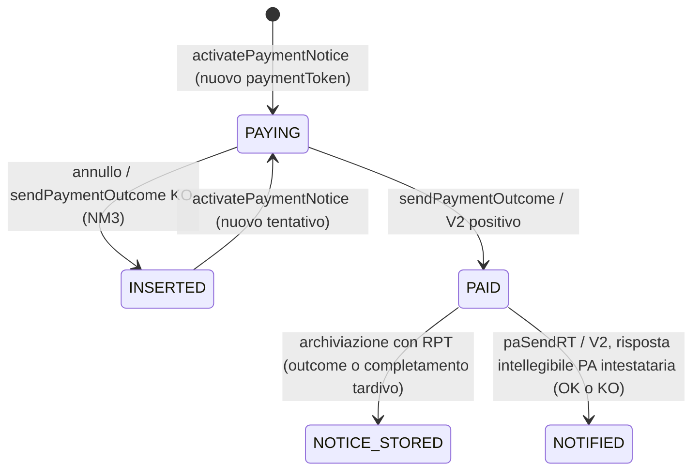
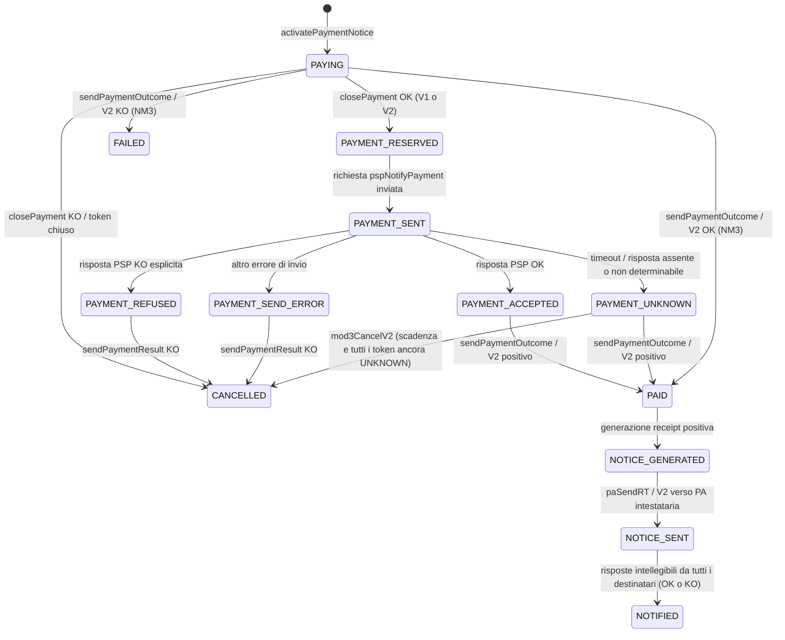
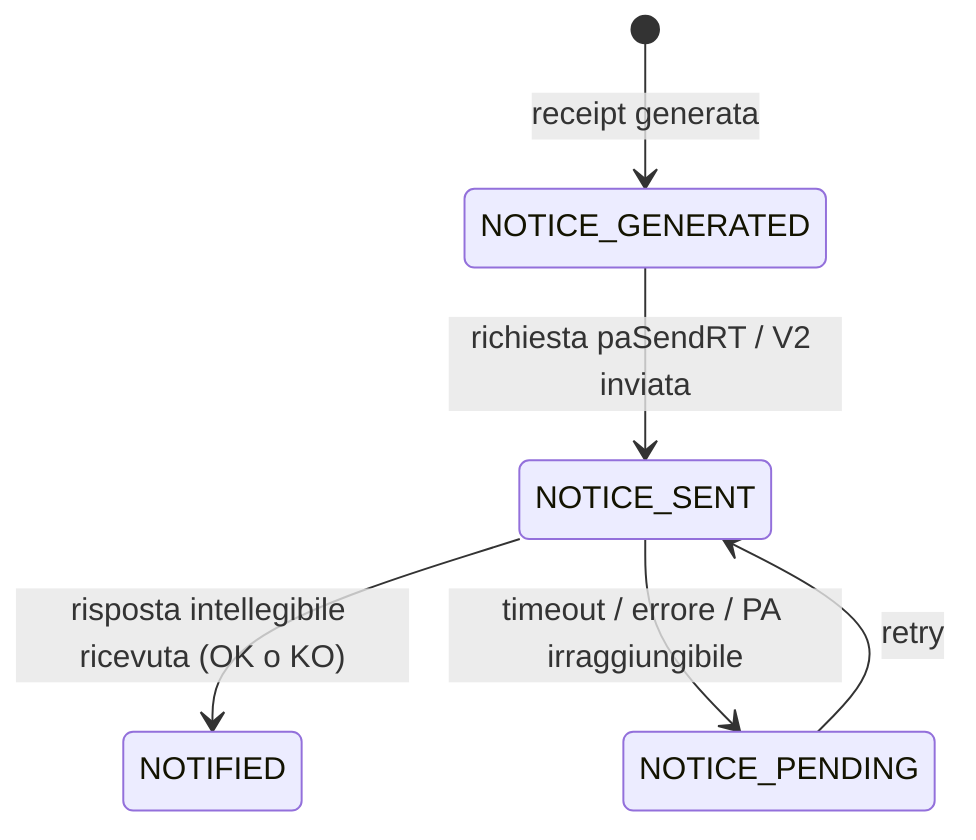

# FSM degli stati di pagamento

## Ambito e chiavi

Il diagramma del SD `PPA-5. SD DI DETTAGLIO` nomina il solo stato logico della posizione (`Open` e `Open → Closed`). Il codice implementa invece stati distinti per posizione, tentativo di pagamento e destinatari della ricevuta; `Open`/`Closed` non sono sufficienti come contratto della FSM.

- **Pagamento logico / posizione:** identificato da `(paFiscalCode, noticeNumber)` (codice fiscale PA + NAV).
- **Tentativo:** identificato dal `paymentToken`. Uno stesso pagamento logico può avere più tentativi; un tentativo annullato non annulla la storia degli altri e può essere seguito da un nuovo token.
- **Destinatario ricevuta:** identificato separatamente per ciascun destinatario PA collegato al pagamento/tentativo.
- `transactionId`, `sessionId` e ID evento sono identificativi distinti e non sostituiscono la coppia PA/NAV o il `paymentToken`.

## Stati persistiti

### Lettura per fasi (decisione del 23 ottobre 2026)

Le fasi sono presentazione, non stati o nuovi filtri API. Storia osservata e
schema dei percorsi sono separati: la storia conserva ordine del servizio,
visite ripetute, provenienza, trigger anche assente e date nulle/non monotone.
I nodi possibili non sono eventi avvenuti. La sintesi non attribuisce un cambio
posizione a un token usando coincidenze temporali.

| Entità | Stato | Fase | Significato e condizione di uscita |
| --- | --- | --- | --- |
| Posizione | `INSERTED` | Attivazione | Inserita o riaperta; nuova attivazione a `PAYING`, senza dedurre un token precedente |
| Posizione | `PAYING` | Attivazione | Attivazione anche diretta; outcome a `PAID`, annullo/KO ammesso a `INSERTED` |
| Posizione | `PAID` | Esito pagamento | Esito positivo; archiviazione a `NOTICE_STORED` oppure risposta PA intestataria a `NOTIFIED` |
| Posizione | `NOTICE_STORED` | Generazione/archiviazione | Ricevuta archiviata; nessuna promozione a `NOTIFIED`, anche dopo consegna |
| Posizione | `NOTIFIED` | Consegna | Risposta intellegibile della PA intestataria, non prova di outcome applicativo OK |
| Tentativo | `PAYING` | Attivazione | Token attivato; close o outcome diretto, senza PSP obbligatorio |
| Tentativo | `PAYING_RPT` | Attivazione legacy | Distinto da `PAYING`; ingresso da confermare per percorso/versione |
| Tentativo | `PAYMENT_RESERVED` | Prenotazione/notifica PSP | Close OK; segue invio PSP, possibile creazione diretta legacy |
| Tentativo | `PAYMENT_SENT` | Prenotazione/notifica PSP | Richiesta PSP inviata; quattro alternative di risposta |
| Tentativo | `PAYMENT_ACCEPTED` | Prenotazione/notifica PSP | Accettato dal PSP, in attesa dell'esito del pagamento; non è `PAID` |
| Tentativo | `PAYMENT_REFUSED` | Prenotazione/notifica PSP | Rifiuto PSP; result KO può annullare |
| Tentativo | `PAYMENT_UNKNOWN` | Prenotazione/notifica PSP | Non risolto; outcome OK a `PAID` o annullo Nodo condizionato a `CANCELLED` |
| Tentativo | `PAYMENT_SEND_ERROR` | Prenotazione/notifica PSP | Errore invio non risolto; result KO a `CANCELLED`, nessun timer client |
| Tentativo | `PAID` | Esito pagamento | Esito positivo; può proseguire nella storia ricevuta |
| Tentativo | `PAID_NORPT` | Esito legacy | Esito positivo senza RPT; completamento differito secondo ramo |
| Tentativo | `FAILED` | Esito pagamento | Outcome KO ammesso; distinto dall'annullo, non riaperto |
| Tentativo | `FAILED_NORPT` | Esito legacy | Outcome KO senza RPT; completamento a `FAILED` |
| Tentativo | `CANCELLED` | Esito pagamento | Token annullato; nuovo tentativo è un altro token |
| Tentativo | `CANCELLED_NORPT` | Esito legacy | Annullo senza RPT; ingresso non confermato, completamenti secondo percorso |
| Tentativo | `NOTICE_GENERATED` | Generazione/archiviazione | Ricevuta generata; invio oppure archiviazione secondo percorso |
| Tentativo | `NOTICE_STORED` | Generazione/archiviazione | Ricevuta archiviata, non prova di consegna; uscita PDF da confermare |
| Tentativo | `NOTICE_SENT` | Consegna | Invio PA intestataria; completamento richiede risposte di tutti i destinatari previsti |
| Tentativo | `NOTIFIED` | Consegna | Risposte intellegibili di tutti i destinatari, anche applicativamente KO |
| Destinatario | `NOTICE_GENERATED` | Generazione/archiviazione | Record ricevuta generato; possibile invio |
| Destinatario | `NOTICE_SENT` | Consegna | Invio a quel destinatario; risposta oppure timeout/errore |
| Destinatario | `NOTICE_PENDING` | Consegna | Consegna in sospeso; retry a `NOTICE_SENT` senza cambiare tentativo |
| Destinatario | `NOTIFIED` | Consegna | Risposta intellegibile del singolo destinatario; non prova esito PA OK |

L'archiviazione durante `sendPaymentOutcome` con RPT comprende tentativo
`PAID → NOTICE_GENERATED → NOTICE_STORED` e posizione `PAYING → PAID →
NOTICE_STORED`; è distinta dalla RPT tardiva completata da `NodoInviaRPT`.
Il PDF pp. 1–4 descrive anche `NOTICE_STORED → NOTICE_SENT` sul tentativo:
**applicabilità da confermare** con evidenza Nodo/RE e versione/percorso.
Finché il gate non è risolto, nessuna estensione generale della raggiungibilità;
eventi realmente presenti nello storico restano comunque osservati, non eliminati.

Il contratto minimo del destinatario usa PA/NAV e `stazione_recipient`, ID
tecnico, stato, timeline, provenienza e revisione. Senza relazione certificata
al tentativo e completezza del set, la vista resta per posizione: niente ruoli
intestatari dedotti dalla stazione e niente percentuali o conteggi "2 di 3".
Array vuoto significa nessun record disponibile, non contratto mancante.
I conteggi dei tentativi riguardano solo quelli disponibili in retention.

Gli enum nel codice sono separati per entità. Le etichette ripetute (ad esempio `NOTIFIED`) indicano stati di record diversi.

| Entità | Stati presenti negli enum |
|---|---|
| Posizione logica (`PositionStatusEnum`) | `INSERTED`, `PAYING`, `PAID`, `NOTICE_STORED`, `NOTIFIED` |
| Tentativo (`PaymentStatusEnum`) | `PAYING`, `PAYING_RPT`, `PAID_NORPT`, `PAID`, `FAILED_NORPT`, `FAILED`, `CANCELLED`, `CANCELLED_NORPT`, `NOTICE_GENERATED`, `NOTICE_STORED`, `NOTICE_SENT`, `NOTIFIED`, `PAYMENT_RESERVED`, `PAYMENT_SENT`, `PAYMENT_ACCEPTED`, `PAYMENT_REFUSED`, `PAYMENT_UNKNOWN`, `PAYMENT_SEND_ERROR` |
| Destinatario (`RecipientStatusEnum`) | `NOTICE_GENERATED`, `NOTICE_SENT`, `NOTICE_PENDING`, `NOTIFIED` |

Gli stati correnti sono mantenuti negli snapshot e le transizioni nelle tabelle di storico. `activation_pending` è un flag aggiuntivo, non uno stato. Il codice mantiene anche uno stato RPT separato, non rappresentato nei diagrammi sotto.

### Raccordo con gli status RE

La revisione basata su `docs/analysis/Analisi status RE.md` distingue **stato raggiunto**, **evento RE di cambio stato** e **trigger applicativo**. Il prefisso RE identifica l'entità; non identifica la causa della transizione. Per esempio `payment_CANCELLED` può derivare da `closePayment`, da `sendPaymentResult` KO o da un job di scadenza: il solo stato di arrivo non permette di scegliere il trigger.

La forma coerente con il contratto documentato è `<prefisso><stato enum>`: `payment_PAYMENT_SENT` per il tentativo in `PAYMENT_SENT`, `position_PAID` per la posizione in `PAID`, `receipt_recipient_NOTICE_PENDING` per il destinatario in `NOTICE_PENDING`. Questo raccordo non certifica che ogni valore sia già stato osservato su Event Hubs.

Anche `tipoEvento` può identificare il flusso applicativo anziché la chiamata immediata: nei campioni locali `docs/analysis/re_messages.json`, `payment_NOTIFIED` ha `tipoEvento = sendPaymentOutcomeV2`. La tabella dei trigger sotto descrive le cause applicative possibili, non una riscrittura del campo sorgente in `paSendRTV2`. Se manca l'evidenza della causa precisa, va conservata la provenienza disponibile senza inventare il dettaglio.

La nuova analisi non è un elenco esaustivo e presenta tre discrepanze da non trasformare automaticamente in nuove transizioni:

| Indicazione nell'analisi RE | Raccordo con la FSM | Decisione documentale |
|---|---|---|
| `payment_SENT`, `payment_ACCEPTED`, `payment_REFUSED`, `payment_SEND_ERROR`, `payment_UNKNOWN` | gli stati enum sono `PAYMENT_SENT`, `PAYMENT_ACCEPTED`, `PAYMENT_REFUSED`, `PAYMENT_SEND_ERROR`, `PAYMENT_UNKNOWN`; i valori RE attesi hanno quindi anche il prefisso di entità `payment_` | mantenere i nomi originali degli enum; verificare campioni prima di introdurre alias |
| `position_CANCELLED` | `CANCELLED` non compare nei 5 stati documentati di `PositionStatusEnum`; i flussi di annullo esaminati producono `payment_CANCELLED` e `position_INSERTED` | candidato non confermato, nessun arco o nuovo stato logico aggiunto |
| `position_NOTIFIED` come ricevuta «accettata con successo» | `paSendRT`/`paSendRTV2` aggiornano lo stato anche con risposta applicativa KO, purché intellegibile | non equiparare `NOTIFIED` a esito applicativo OK |

`receipt_recipient_STATUS` è una notazione generica, non un quinto stato del destinatario. I quattro stati effettivi restano quelli dell'enum. **Dal 22 ottobre 2026 questi eventi sono inclusi nella proiezione** come **terza entità** (destinatario ricevuta), accanto a `payment_*` (tentativo) e `position_*` (posizione); questa decisione supera la precedente esclusione descritta qui, nella specifica di superamento mock §7.1 e in AC-06. Il destinatario è identificato dalla coppia logica `(paFiscalCode, noticeNumber)` più `stazione_recipient` (dal campo `info`); il `paymentToken` viaggia nella ricevuta ma non identifica il destinatario. Gli stati omonimi (`NOTICE_GENERATED`, `NOTICE_SENT`, `NOTIFIED`) restano attribuiti all'entità indicata dal prefisso e non vanno fusi con quelli del tentativo.

## 1. FSM della posizione logica

Ogni nuova attivazione crea/associa un tentativo e porta la posizione a `PAYING`. Dopo il fallimento/cancellazione di un tentativo, il pagamento logico può tornare `INSERTED` e ricevere un nuovo tentativo.

`PAID` e `NOTIFIED` sono fasi differenti: il pagamento può risultare `PAID` prima della conclusione delle notifiche. `NOTICE_STORED` è uno stato della posizione usato in percorsi legacy/RPT; non va fuso con `PAID` o `NOTIFIED`.

Il ritorno `PAYING → INSERTED` comprende anche `closePayment` KO e gli annulli di validazione di `closePaymentV2`, non solo KO PSP o scadenza. Non va rappresentato come `position_CANCELLED`. Un primo `position_INSERTED` osservato non dimostra, da solo, che sia esistito un tentativo precedente: può indicare inserimento o riapertura, da distinguere usando il contesto disponibile.

## 2. FSM di ciascun tentativo (`paymentToken`)

Il diagramma si applica a ogni token separatamente, anche quando più token appartengono allo stesso pagamento logico.

Precisazioni sul flusso:

- `PAYMENT_RESERVED` è scritto sia da `ClosePaymentActorV1` sia da `ClosePaymentActorV2`; non è uno stato esclusivo di V1.
- V1 invia `sendPaymentResult` in linea con la risposta di `pspNotifyPayment`: OK per `PAYMENT_ACCEPTED`, KO per un esito rifiutato/errore. Se l'esito è `PAYMENT_UNKNOWN`, il risultato non viene inviato in quel passaggio.
- In V2 `PAYMENT_ACCEPTED` attende `sendPaymentOutcome`; l'esito positivo di `sendPaymentOutcomeV2` può inoltre risolvere `PAYMENT_UNKNOWN` portandolo a `PAID`.
- Il percorso NM3 attivato presso PSP può ricevere direttamente `sendPaymentOutcome` o `sendPaymentOutcomeV2` da `PAYING`, senza passare per `closePayment` e gli stati `PAYMENT_*`: OK porta a `PAID`, KO a `FAILED` e riapre la posizione in `INSERTED`. Questa non è una risposta KO di `pspNotifyPayment`.
- La chiamata V1 a `sendPaymentResult` non equivale, da sola, alla transizione persistita del tentativo a `PAID`; il completamento dipende dal successivo flusso di esito.
- `PAYMENT_UNKNOWN` non è un KO terminale. Per il percorso NMU, `mod3CancelV2` cancella i pagamenti solo quando tutti i token del gruppo risultano ancora `PAYMENT_UNKNOWN`; allora porta i tentativi a `CANCELLED` e le posizioni a `INSERTED`.
- `CANCELLED` è terminale per quel tentativo, non per il pagamento logico: una nuova attivazione può creare un altro `paymentToken`.
- `PAID` non è terminale rispetto alla storia della ricevuta del tentativo: può essere seguito da `NOTICE_GENERATED`, `NOTICE_SENT`, `NOTIFIED`. Un timeout della PA non trasforma il tentativo in `PAYMENT_UNKNOWN` o `NOTICE_PENDING`: quest'ultimo stato appartiene solo al destinatario.

### Percorsi legacy / senza RPT

Il codice conserva anche stati del flusso legacy che non sono tutti rappresentabili nel diagramma principale:

| Caso | Transizione osservata |
|---|---|
| `sendPaymentOutcome` OK su flusso legacy | `PAYING` / `PAYING_RPT` / `CANCELLED_NORPT` → `PAID` oppure `PAID_NORPT` |
| `sendPaymentOutcome` KO su flusso legacy | `PAYING` / `PAYING_RPT` / `CANCELLED_NORPT` → `FAILED` oppure `FAILED_NORPT` |
| Gestione successiva di `PAID_NORPT` in `NodoInviaRPT` | tentativo → `PAID`, `NOTICE_GENERATED`, `NOTICE_STORED`; posizione → `NOTICE_STORED` |
| Gestione successiva di `FAILED_NORPT` / `CANCELLED_NORPT` | rispettivamente → `FAILED` / `CANCELLED` |
| `closePayment` V1 OK su PA OLD | creazione del payment direttamente in `PAYMENT_RESERVED`; non inferire un precedente `PAYING` dello stesso token senza evidenza |
| `closePaymentV2` su PA OLD | accettazione OK/KO con payment in `PAYING_RPT`; assenza della RPT (`PAYING`) causa annullo, non prenotazione |

Questi stati devono restare distinguibili nella storia. La loro copertura va associata alla versione di primitiva e al percorso applicativo effettivi.

La presenza di `PAYING_RPT` e `CANCELLED_NORPT` negli enum non documenta da sola i loro archi di ingresso. L'arrivo della RPT è un trigger da verificare per `PAYING_RPT`; per l'ingresso in `CANCELLED_NORPT` occorre verificare il ramo di annullo senza RPT. Non si aggiungono archi generici né si usa `activatePaymentNotice` come spiegazione automatica di `PAYING_RPT`.

## 3. FSM della ricevuta per destinatario

La ricevuta è generata dopo l'esito positivo; ogni destinatario ha un proprio stato e retry.

- Il tentativo di invio aggiorna il destinatario a `NOTICE_SENT`; la risposta valida lo porta a `NOTIFIED`.
- Timeout, errore di risposta o indisponibilità inseriscono lavoro di retry e portano il destinatario a `NOTICE_PENDING`.
- Quando tutti i destinatari previsti hanno una risposta, il pagamento può passare da `NOTICE_SENT` a `NOTIFIED`. La posizione passa a `NOTIFIED` sulla risposta della PA intestataria (con le condizioni applicative previste per il multibeneficiario).
- `NOTIFIED` indica che è arrivata una risposta valida: l'esito applicativo OK/KO della risposta va mantenuto separato e non dedotto dallo stato.
- Nei flussi stand-in l'invio dipende da `CONFIGURATION_KEYS.invioReceiptStandin`. Con invio disabilitato la generazione non implica `NOTICE_SENT`/`NOTIFIED`; non inventare un errore o un retry. La sola configurazione non dimostra una transizione a `NOTICE_STORED`.

## Transizioni per primitiva

| Primitiva/evento | Tentativo | Posizione logica | Nota |
|---|---|---|---|
| `activatePaymentNotice` | nuovo token `PAYING` | `PAYING` | chiave posizione PA/NAV |
| `activatePaymentNoticeV2` | nuovo token `PAYING` | `PAYING` | stessa separazione delle entità di V1 |
| `closePayment` OK V1/V2 | `PAYING → PAYMENT_RESERVED` | resta `PAYING` | V1 e V2 |
| `closePayment` KO V1/V2 | `PAYING → CANCELLED` (o `PAYING_RPT` nei percorsi PA OLD V2) | `PAYING → INSERTED` | in V1 PA OLD KO non viene creato un payment: non inventare un tentativo |
| Annulli di validazione `closePaymentV2` | token conosciuti coinvolti → `CANCELLED` | posizioni corrispondenti → `INSERTED` | token sconosciuto/scaduto nel gruppo o PA OLD senza RPT; nessuna proiezione per il token sconosciuto |
| Invio `pspNotifyPayment` / `pspNotifyPaymentV2` | `PAYMENT_RESERVED → PAYMENT_SENT` nel flusso close | invariata | la versione della primitiva non introduce nuovi stati |
| Risposta PSP | `PAYMENT_SENT → PAYMENT_ACCEPTED / PAYMENT_REFUSED / PAYMENT_UNKNOWN / PAYMENT_SEND_ERROR` | invariata | errore non determinabile ≠ KO |
| `sendPaymentResult` / `sendPaymentResultV2` KO | `PAYMENT_REFUSED` o `PAYMENT_SEND_ERROR → CANCELLED` | `PAYING → INSERTED` | la risposta PM è informativa; non è il trigger di `PAID` |
| `mod3CancelV2` | `PAYMENT_UNKNOWN → CANCELLED` | `PAYING → INSERTED` | asincrono, solo alle condizioni sopra |
| `sendPaymentOutcome` / `sendPaymentOutcomeV2` positivo | `PAYMENT_ACCEPTED` o `PAYMENT_UNKNOWN → PAID` nel flusso close; `PAYING → PAID` in NM3; stati legacy secondo percorso | `PAYING → PAID` | genera la ricevuta |
| `sendPaymentOutcome` / `sendPaymentOutcomeV2` KO NM3 | `PAYING → FAILED` | `PAYING → INSERTED` | non estendere il KO al flusso NM1/appIO, che accetta solo outcome OK |
| `sendPaymentOutcome` KO legacy | `PAYING` / `PAYING_RPT` / `CANCELLED_NORPT` → `FAILED` o `FAILED_NORPT` | dipende dal percorso | non confondere con KO PSP |
| Generazione receipt dopo outcome OK | `PAID → NOTICE_GENERATED` | resta `PAID` | destinatario inizializzato a `NOTICE_GENERATED`; fase interna, non nuova primitiva |
| Archiviazione durante outcome con RPT | `PAID → NOTICE_GENERATED → NOTICE_STORED` | `PAYING → PAID → NOTICE_STORED` | percorso PDF distinto dalla RPT tardiva; non implica invio successivo generalmente raggiungibile |
| `NodoInviaRPT` dopo outcome anticipato | `PAID_NORPT → PAID`, poi `NOTICE_GENERATED` / `NOTICE_STORED`; `FAILED_NORPT → FAILED`; `CANCELLED_NORPT → CANCELLED` | `NOTICE_STORED` nel ramo legacy previsto | non imporre la stessa sequenza a tutti i percorsi |
| `paSendRT` / `paSendRTV2` request | `NOTICE_GENERATED → NOTICE_SENT` quando si invia alla PA intestataria | invariata | separatamente, destinatario `NOTICE_GENERATED → NOTICE_SENT` |
| `paSendRT` / `paSendRTV2` response | `NOTICE_SENT → NOTIFIED` solo dopo le risposte di tutti i destinatari | `PAID → NOTIFIED` sulla risposta PA intestataria, quando applicabile | destinatario `NOTICE_SENT → NOTIFIED`; risposta intellegibile OK **o KO** |
| `paSendRT` / `paSendRTV2` errore/timeout | nessun nuovo stato del tentativo deducibile | invariata | solo destinatario `NOTICE_SENT → NOTICE_PENDING`, con retry asincrono |
| Retry `paSendRT` / `paSendRTV2` (`RetryPaSendRtActor`) | eventuale completamento a `NOTIFIED` alle condizioni sopra | eventuale `NOTIFIED` alle condizioni sopra | destinatario `NOTICE_PENDING → NOTICE_SENT`, poi esito; non riaprire un tentativo annullato |
| `positionRetrySendPaymentResult` V1/V2 | nessuna nuova transizione di business documentata per il solo retry | invariata per il solo retry | aggiorna la coda tecnica; una risposta PM non prova il pagamento o la consegna alla PA |
| `verifyPaymentNotice`, `paymentStatus` | nessuna transizione di business | nessuna transizione di business | consultazione/validazione, eventi di interfaccia esclusi |

La scadenza è un trigger applicativo del Nodo, non un timer della piattaforma di osservabilità. Il consumer non annulla token per decorrenza locale: attende gli eventi di cambio stato. Nel caso NMU il gruppo e la concorrenza con l'outcome sono gestiti dal Nodo; la proiezione non ricostruisce `transactionId`, gruppi o flag `busy` fuori perimetro.

### Copertura di tutti gli stati e trigger da completare

La revisione copre i 5 stati della posizione, i 18 del tentativo e i 4 del destinatario. La tabella distingue trigger documentati da collegamenti ancora da verificare; non è una regola per dedurre la causa dal solo stato.

| Entità | Stato/i di arrivo | Trigger documentati / limite dell'evidenza |
|---|---|---|
| Posizione | `INSERTED` | `closePayment` KO/annullo, `sendPaymentResult` KO, `mod3CancelV2`, outcome KO NM3; inserimento iniziale citato dall'analisi RE ma trigger non precisato |
| Posizione | `PAYING` | attivazione V1/V2, inclusa nuova attivazione dopo riapertura |
| Posizione | `PAID` | outcome positivo V1/V2 |
| Posizione | `NOTICE_STORED` | gestione legacy/RPT in `NodoInviaRPT`; non una risposta PA |
| Posizione | `NOTIFIED` | risposta intellegibile PA intestataria, con condizioni multibeneficiario previste |
| Tentativo | `PAYING` | attivazione V1/V2 |
| Tentativo | `PAYING_RPT` | stato attestato; trigger di ingresso all'arrivo RPT da verificare, non confondere con attivazione |
| Tentativo | `PAYMENT_RESERVED` | `closePayment` OK V1/V2; creazione diretta V1 PA OLD |
| Tentativo | `PAYMENT_SENT` | invio notifica PSP V1/V2 |
| Tentativo | `PAYMENT_ACCEPTED`, `PAYMENT_REFUSED` | risposta PSP rispettivamente OK/KO |
| Tentativo | `PAYMENT_UNKNOWN`, `PAYMENT_SEND_ERROR` | rispettivamente timeout/errore response e PSP irraggiungibile |
| Tentativo | `PAID`, `PAID_NORPT` | outcome OK secondo percorso; `NodoInviaRPT` completa `PAID_NORPT → PAID` |
| Tentativo | `FAILED`, `FAILED_NORPT` | outcome KO NM3/legacy secondo percorso; `NodoInviaRPT` completa `FAILED_NORPT → FAILED` |
| Tentativo | `CANCELLED` | close KO/annullo, result KO, job di scadenza; completamento legacy da `CANCELLED_NORPT` |
| Tentativo | `CANCELLED_NORPT` | stato attestato; ingresso nel ramo annullo senza RPT da verificare |
| Tentativo | `NOTICE_GENERATED` | generazione receipt positiva dopo outcome o gestione differita RPT |
| Tentativo | `NOTICE_STORED` | ramo legacy/RPT: ricevuta conservata e non inviata come receipt; non prova consegna PA |
| Tentativo | `NOTICE_SENT` | invio receipt alla PA intestataria |
| Tentativo | `NOTIFIED` | risposte intellegibili di tutti i destinatari, non necessariamente OK |
| Destinatario | `NOTICE_GENERATED` | generazione receipt/destinatario |
| Destinatario | `NOTICE_SENT` | primo invio o retry receipt verso quel destinatario |
| Destinatario | `NOTICE_PENDING` | timeout, errore response o PA irraggiungibile |
| Destinatario | `NOTIFIED` | risposta intellegibile OK/KO di quel destinatario |

**Trigger aggiungibili alla documentazione:** versioni V2 delle primitive, outcome diretto NM3 (OK e KO), annulli di validazione close V2, generazione receipt, completamenti legacy e retry con i limiti sopra. Non emergono nuovi stati enum confermati dalla sola analisi RE. Rimangono da verificare gli ingressi legacy incompleti, la grafia effettiva degli status RE e `position_CANCELLED`.

**Vincolo per l'inferenza:** i percorsi NM3 e V1 PA OLD rendono non univoco il percorso verso `PAID` e `PAYMENT_RESERVED`. Non inferire sempre `PAYMENT_ACCEPTED` prima di `PAID`, né `PAYING` prima di `PAYMENT_RESERVED`; servono evidenze del percorso. Analogamente, da `NOTIFIED` non si inferisce un esito applicativo OK.

## Evidenze e correzioni rispetto al diagramma SD

- Il diagramma SD `Open → Closed` è una vista concettuale. Nel codice la posizione passa a `PAID` prima dell'invio/conclusione della ricevuta, poi a `NOTIFIED`.
- I pagamenti falliti sono tentativi distinti: il ritorno della posizione a `INSERTED` abilita una nuova attivazione con un nuovo token; non cancella lo storico degli altri tentativi.
- `PAYMENT_RESERVED` è presente anche in V2.
- Il KO PSP e l'esito KO di `sendPaymentOutcome` sono percorsi distinti; un timeout PSP può lasciare il tentativo `PAYMENT_UNKNOWN`, poi risolto da un outcome positivo oppure cancellato asincronamente.
- `NOTICE_PENDING` appartiene al destinatario della ricevuta, non è uno stato della posizione.
- Gli snapshot rappresentano lo stato corrente; gli aggiornamenti appendono lo storico. Il codice non va trattato come un'unica FSM event-sourced.

## Classificazione esito e raccordo con `Analisi paymentStatus`

`docs/analysis/Analisi paymentStatus.md` (API Nodo `GET /paymentstatus`, campo `POSITION_PAYMENT_STATUS_SNAPSHOT.status`) descrive gli stessi 18 stati del tentativo e assegna a ciascuno un **esito piatto a 3 valori** usato lato Nodo/eCommerce: `OK`, `IN CORSO`, `KO`.

La piattaforma di osservabilità conserva questo esito come informazione aggiuntiva ma lo rimappa su una classificazione a 4 categorie (`info` ≈ IN CORSO, `ok` ≈ OK, `mute` ≈ KO, più **`warn` = "non risolto"**), definita in un unico punto (`src/app/models/domain.ts`, `STATE_CATEGORIES`). La categoria `warn`/`non risolto` isola `PAYMENT_UNKNOWN` e `PAYMENT_SEND_ERROR` fino alla loro risoluzione (warning solo visivi). Le etichette IT ufficiali dei 18 stati derivano dai significati di questo documento di analisi.

**Nessun drift di insieme:** l'enum dei 18 stati coincide tra analisi, questa FSM, la spec di piattaforma, `ATTEMPT_STATES` e l'OpenAPI della piattaforma. Gli eventi RE `paymentStatus` sono di `CATEGORIA_EVENTO = INTERFACCIA` e vengono scartati dal filtro di ammissione del consumer: non entrano nella proiezione.

**Drift semantici aperti (da chiarire col prodotto):**

- `PAYMENT_SEND_ERROR`: l'analisi lo classifica come esito `KO` terminale, mentre questa FSM lo tratta come stato **intermedio** (`PAYMENT_SEND_ERROR → CANCELLED`) e la piattaforma come **non risolto** (`warn`). Decidere se è terminale o intermedio.
- `NOTIFIED`: l'analisi gli assegna esito `OK`, mentre la spec di piattaforma precisa che `NOTIFIED` indica solo "risposta ricevuta" e non va letto da solo come esito positivo.

## Riferimenti al codice

### Raccordo con «Cambiamento di stati» del 22 ottobre 2026

Il confronto con `docs/analysis/Cambiamento di stati-221026-152110.pdf` è raccolto in [Raccordo Cambiamento di stati 221026](../analysis/Raccordo%20Cambiamento%20di%20stati%20221026.md), che distingue evidenze del PDF, copertura locale e punti da verificare nel Nodo.

- Il PDF conferma chiavi separate, prenotazione V1/V2, outcome diretto NM3, risoluzione di `PAYMENT_UNKNOWN` e significato non necessariamente positivo di `NOTIFIED`. Non introduce nuovi enum; il nodo grafico `PAYING / PAYING_RPT` non fonde i due stati.
- Le pp. 2–3 descrivono anche l'archiviazione durante `sendPaymentOutcome` con RPT presente: tentativo `NOTICE_GENERATED → NOTICE_STORED` e posizione `PAID → NOTICE_STORED`. È un trigger aggiuntivo rispetto al completamento tardivo in `NodoInviaRPT` riportato sopra; manca uno scenario mock dedicato.
- La p. 4 esplicita la guardia già compatibile con il grafo logico: la posizione passa a `NOTIFIED` solo se ancora `PAID` e alle condizioni del destinatario; se già `NOTICE_STORED`, vi rimane anche quando tentativo e destinatari progrediscono.
- Il diagramma Payment ammette `NOTICE_STORED → NOTICE_SENT`, mentre il grafo UI e i test trattano il primo stato come terminale e questa FSM lo associa al ramo di sola conservazione. **Resta una divergenza da verificare per percorso/versione Nodo**, non un arco introdotto automaticamente per tutti i flussi.
- Il diagramma Position aggiunge i trigger legacy `nodoInviaRPT` per l'inserimento, `nodoInviaRT` e job `pspChiediListaAndChiediRT` per RT OK/KO e `mod3CancelV1/V2` per annullo ammesso. Non specifica tutti gli archi corrispondenti del tentativo né i valori RE effettivamente emessi.

Il raccordo segnala inoltre l'attuazione incompleta della decisione sui destinatari ricevuta: presenti nella specifica backend e nel frontend, ma assenti dal contratto OpenAPI e dalle risposte mock esaminate. Questo disallineamento preesistente non va interpretato come esclusione del destinatario da parte del nuovo PDF.

### Provenienza dei riferimenti Nodo

Questi sono i riferimenti al codice raccolti dalla documentazione preesistente, non una nuova verifica del repository Nodo. Il raccordo RE e i trigger aggiuntivi sono stati confrontati con le analisi locali seguenti:

- `docs/analysis/Analisi status RE.md`, famiglie RE e sezione di raccordo.
- `docs/analysis/Analisi closePayment [PM - Nodo].md`, sezioni «Update stato RPT/PAYMENT», «Update stato posizione debitoria» e «Salvataggio log su Registro Eventi».
- `docs/analysis/Analisi closePaymentV2 [PM-SC-Nodo].md`, sezioni «Token valido?», «Annullo dei token» e «Salvataggio log su Registro Eventi».
- `docs/analysis/Analisi pspNotifyPayment.md` e `Analisi pspNotifyPaymentV2 [Nodo-PSP].md`, tabelle degli esiti PSP. Le analisi riportano ancora `PAYING → PAYMENT_SENT`; il passaggio intermedio `PAYMENT_RESERVED` nel flusso close è documentato dai riferimenti al codice sotto e non va eliminato.
- `docs/analysis/Analisi sendPaymentOutcome.md`, tabelle di update position/payment e verifica outcome; `Analisi sendPaymentOutcomeV2 [PSP - Nodo].md`, sezioni «Check stato payment» e «Update stati position e payment».
- `docs/analysis/Analisi sendPaymentResult [Nodo-PM-SC].md` e `Analisi sendPaymentResultV2 [Nodo-PM].md`, trigger, annullo e risposta informativa.
- `docs/analysis/Analisi mod3cancelV2 per NMU.md`, opzione 2 accettata; `Analisi positionRetrySendPaymentResult.md`, retry tecnico V1/V2.
- `docs/analysis/Analisi paSendRT.md` e `Analisi paSendRTV2.md`, update separati recipient/payment/position e vincolo stand-in.
- `docs/analysis/Analisi paymentStatus.md`, insieme completo degli stati del tentativo, non contratto degli archi di transizione.

Percorsi relativi alla root `pagopa-nodo4-nodo-dei-pagamenti`:

- Enum degli stati: `nodo4/src/main/scala/eu/sia/pagopa/common/repo/online/model/PaymentPositions.scala:10-20`.
- Chiavi PA/NAV e token nei modelli: `nodo4/src/main/scala/eu/sia/pagopa/common/repo/online/model/PaymentPositions.scala:65-76,90-98`.
- Attivazione e snapshot `PAYING`: `nodo4/src/main/scala/eu/sia/pagopa/modello3/actor/ActivatePaymentNoticeBaseActor.scala:1062-1078`.
- Close V1 `PAYMENT_RESERVED`, invio PSP e mapping risposta: `nodo4/src/main/scala/eu/sia/pagopa/modello1/ClosePaymentActorV1.scala:193-221,390,696-779`.
- Close V2 `PAYMENT_RESERVED`: `nodo4/src/main/scala/eu/sia/pagopa/modello1/ClosePaymentActorV2.scala:555-606,630`.
- `PAYMENT_SENT`, stati PSP, KO e annullamento: `nodo4/src/main/scala/eu/sia/pagopa/common/util/PspNotifyPaymentUtil.scala:74-95,123-168,282-352`.
- Cancellazione NMU condizionata sui token ancora UNKNOWN: `nodo4/src/main/scala/eu/sia/pagopa/rtpull/actor/Mod3CancelV2Actor.scala:151-165`.
- `sendPaymentOutcome` e generazione ricevuta: `nodo4/src/main/scala/eu/sia/pagopa/rptinvia/actor/SendPaymentOutcomeUtils.scala:252-299,1197-1240`.
- Stati legacy `*_NORPT` e `NOTICE_STORED`: `nodo4/src/main/scala/eu/sia/pagopa/rptinvia/actor/NodoInviaRPTActor.scala:1021-1085`.
- Invio, risposta e retry della ricevuta: `nodo4/src/main/scala/eu/sia/pagopa/common/util/ReceiptUtil.scala:568-644,675-695`; retry batch in `nodo4/src/main/scala/eu/sia/pagopa/rtpull/actor/RetryPaSendRtActor.scala:118-180,220-227`.
- Snapshot e storico: `nodo4/src/main/scala/eu/sia/pagopa/common/repo/online/OnlineRepository.scala:2627-2652`.
